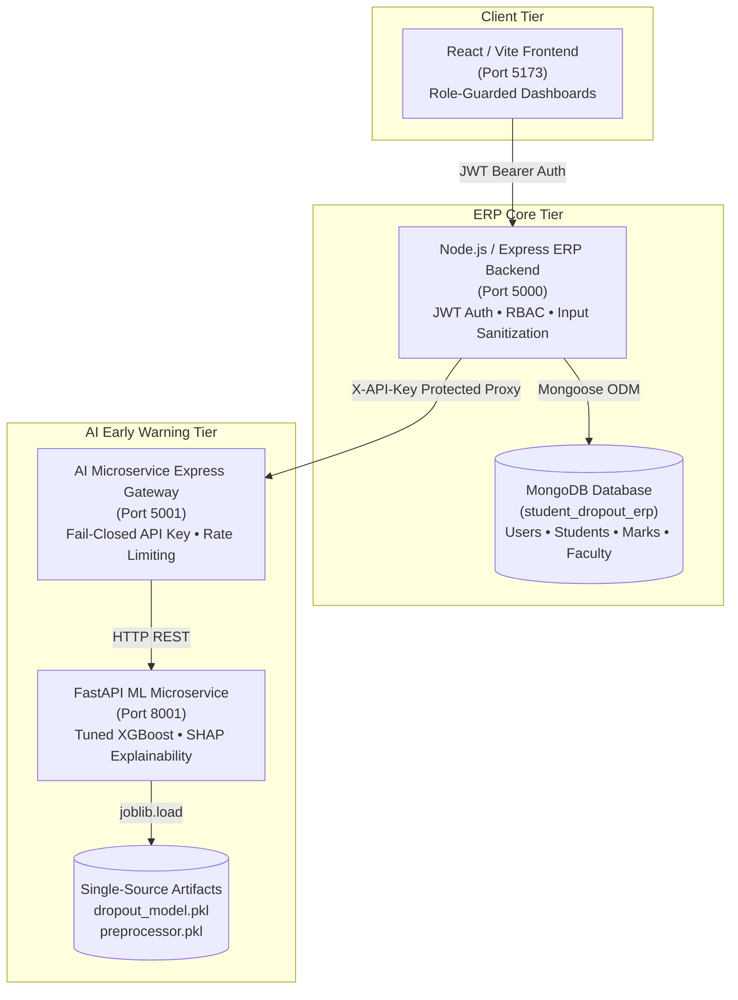

# InSightERP: Academic Student Retention & Early Warning Ecosystem

InSightERP is an enterprise academic management platform integrated with an explainable machine learning early-warning engine to prevent undergraduate student dropout across engineering departments.

---

## 1. System Architecture



---

## 2. Quickstart & Local Setup

### Prerequisites
- Node.js >= 18.x
- Python >= 3.10
- MongoDB (Local community instance or Atlas connection)

### Step 1: First-Time Setup & Secret Generation
Copy the example environment template:
```bash
cd backend
cp .env.example .env
```
Generate cryptographically secure 32-byte hexadecimal secrets:
```bash
node -e "console.log(require('crypto').randomBytes(32).toString('hex'))"
```
Configure `backend/.env` with the generated values:
- `JWT_SECRET`: Random 32+ character hex string (used for signing session JWTs).
- `ERP_SERVICE_API_KEY`: Random 32+ character hex string (shared with AI microservice for meeting request delivery).
- `AI_SERVICE_BASE_URL`: URL of the AI gateway (default: `http://localhost:5001`).
- `AI_SERVICE_API_KEY`: Service key for outgoing calls to AI gateway (must match `API_KEY` in AI microservice).
- `CLIENT_URL`: `http://localhost:5173`.
- `ALLOWED_ORIGINS`: `http://localhost:5173,http://localhost:3000`.
- `MONGO_URI`: Valid MongoDB connection string.

Startup will fail fast with clear diagnostics (`node scripts/check-env.js`) if any required secret is missing, under 32 characters, or contains default placeholders.

### Step 2: Seed the Database
```bash
cd backend
npm install
node scripts/seedDb.js
```
This loads curriculum data, faculty records, course marks, and students, creating bcrypt-hashed demo accounts:
- **Admin**: `admin` / (password from `DEMO_PASSWORD` or printed at seed time)
- **Faculty Mentor**: `mentor`
- **Student**: `student`

### Step 3: Run the Servers
In terminal 1 (Backend):
```bash
cd backend
npm run dev
# Starts on http://localhost:5000
```

In terminal 2 (Frontend):
```bash
cd frontend
npm install
npm run dev
# Starts on http://localhost:5173
```

---

## 3. Running Verification Tests
Execute the comprehensive test runner to verify authentication, ownership controls, feature parity, and Vite production bundle validity:

```powershell
# Windows PowerShell:
.\run_tests.ps1

# Linux / macOS:
chmod +x run_tests.sh
./run_tests.sh
```

Or run individual unit suites:
```bash
cd backend
npm test
```

---

## 4. Security & Role Invariants
- **Student Role**: Strictly scoped to reading their own student profile, marks, and context-grounded AI advisor messages (`403 Forbidden` if querying other students).
- **Mentor Role**: Scoped only to students assigned under their mentor ID.
- **Admin Role**: Authorized for institutional summary metrics and global roster.
- **Fail-Closed Principle**: If `JWT_SECRET` is unset, the server refuses to start.
- Full details documented in [docs/security.md](docs/security.md).
